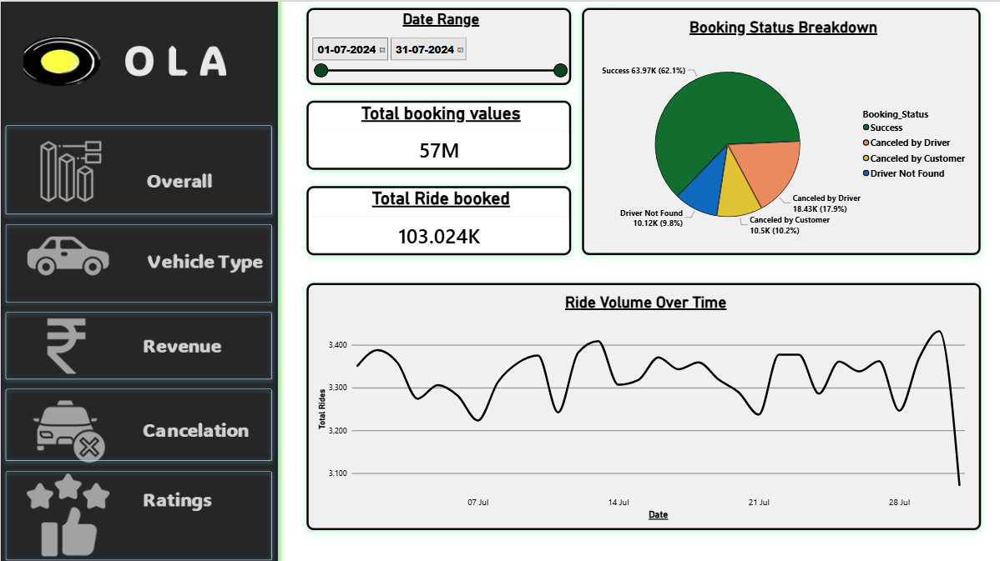
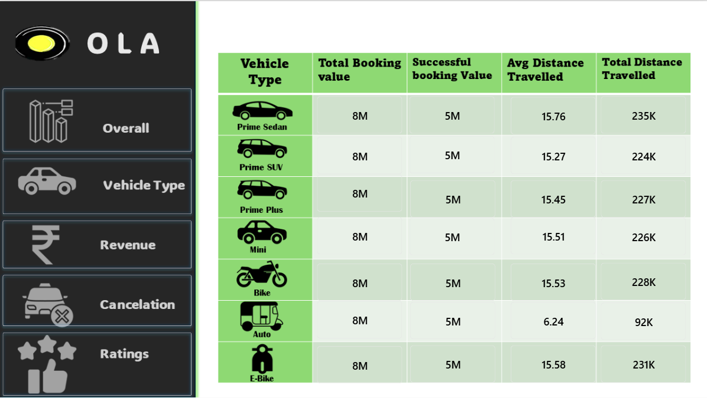
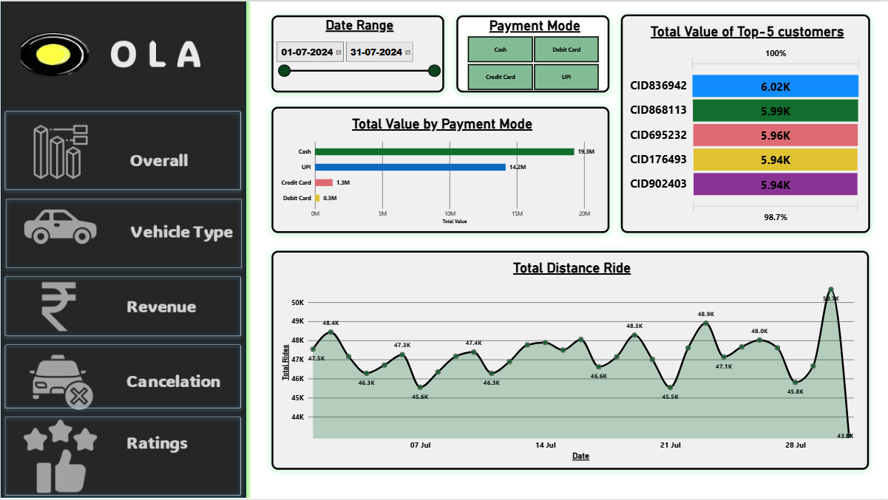
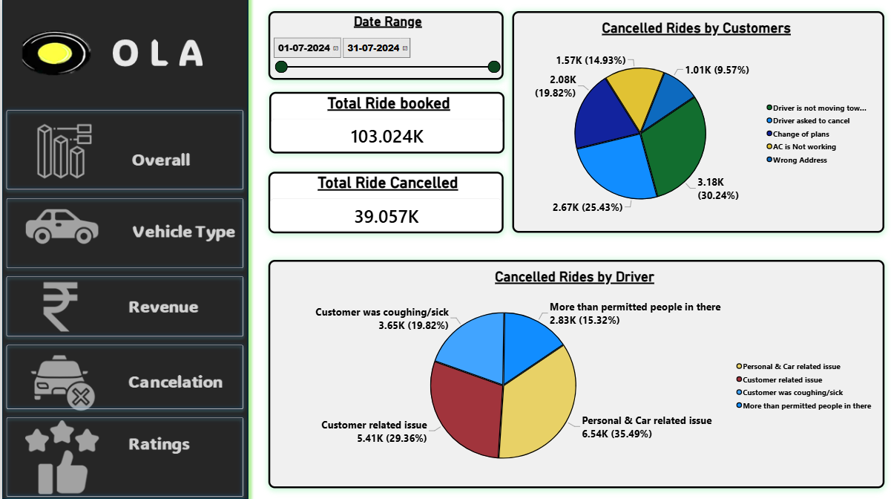
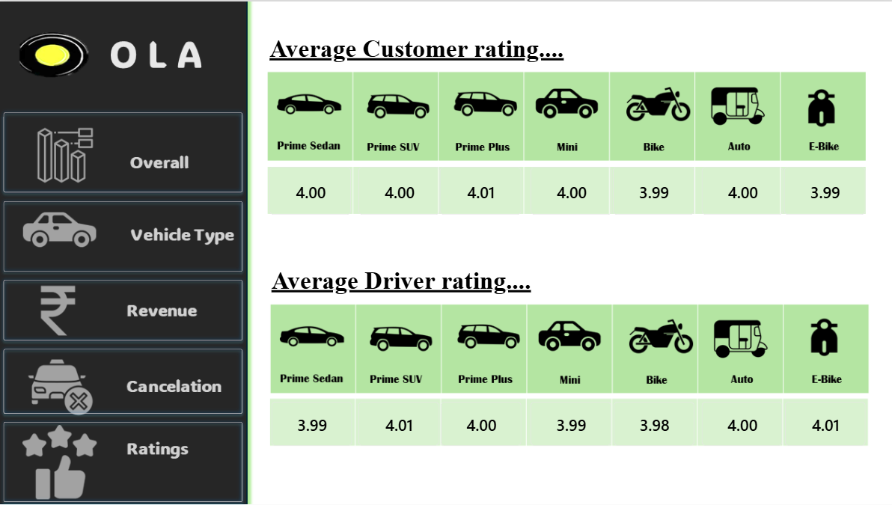

# OLA Ride Booking Data Analytics Dashboard

## Project Overview
This project presents an interactive Power BI dashboard for analyzing OLA ride booking data. It explores booking performance, ride volume, revenue, vehicle types, cancellation patterns, and customer and driver ratings.

## Dashboard Preview
### 1. Overall Dashboard


### 2. Vehicle Type Analysis


### 3. Revenue and Payment Analysis


### 4. Ride Cancellation Analysis


### 5. Customer and Driver Ratings


## Key Performance Indicators (KPIs)
- **Total Booking Value:** 57M
- **Total Rides Booked:** 103.024K
- **Successful Bookings:** 63.97K (62.1%)
- **Rides Cancelled by Drivers:** 18.43K
- **Rides Cancelled by Customers:** 10.5K
- **Driver Not Found:** 10.12K

## Dashboard Features
1. **Overall Performance:** Tracks booking value, ride volume, and booking status.
2. **Vehicle Type Analysis:** Compares booking values and distances across vehicle categories.
3. **Revenue Analysis:** Examines payment methods, customer spending, and ride distance trends.
4. **Cancellation Analysis:** Identifies customer and driver cancellation reasons.
5. **Ratings Analysis:** Compares average customer and driver ratings by vehicle type.
6. **Date Filtering:** Supports analysis of the selected date range.

## Tools and Technologies
- Microsoft Power BI
- Data analysis and visualization
- Power Query
- DAX measures
- Excel or SQL

## Key Observations
- The displayed total booking value is 57M.
- Successful bookings account for approximately 62.1% of bookings in the selected view.
- Cash has the highest displayed payment value, followed by UPI.
- Personal and car-related issues are the largest displayed category of driver cancellations.
- Average customer and driver ratings are close to 4.0 across the listed vehicle types.

## Repository Structure
```text
ola-ride-booking-analysis/
├── dashboard/
│   └── OLA_Ride_Booking_Analysis.pbix
├── images/
│   ├── overall.png
│   ├── vehicle-type.png
│   ├── revenue.png
│   ├── cancellation.png
│   └── ratings.png
├── data/
├── README.md
└── .gitignore
```

## Author
Aryan Nayak
